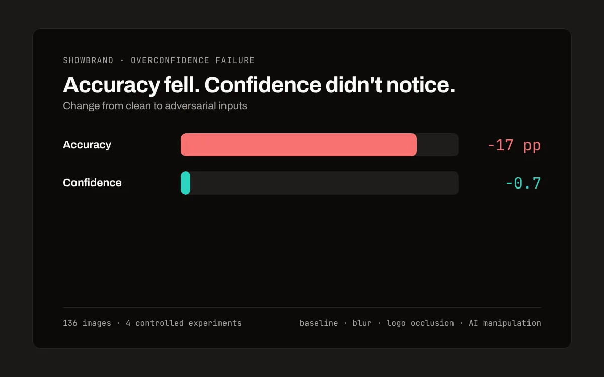
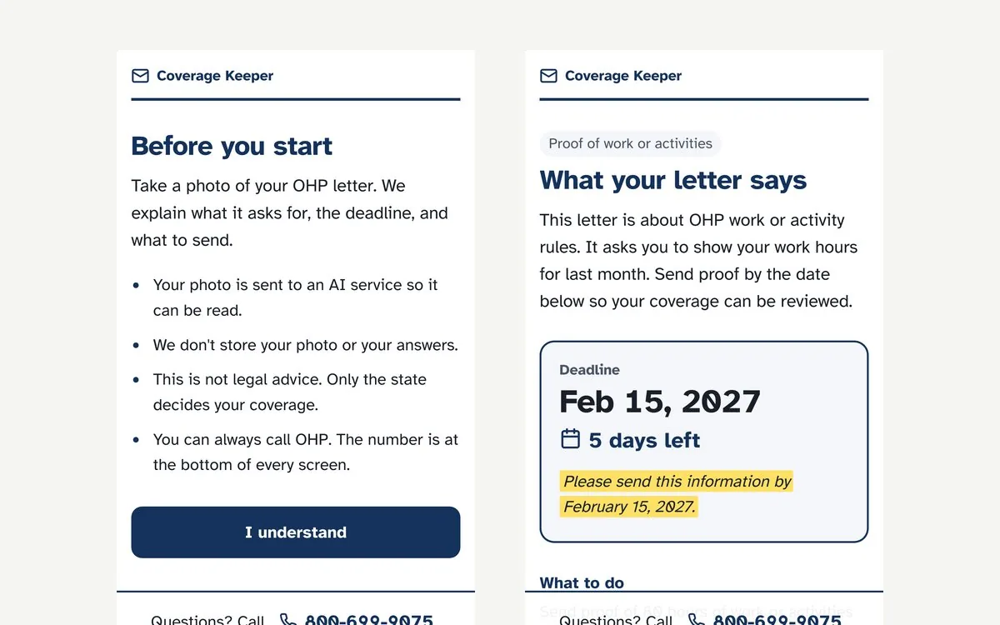
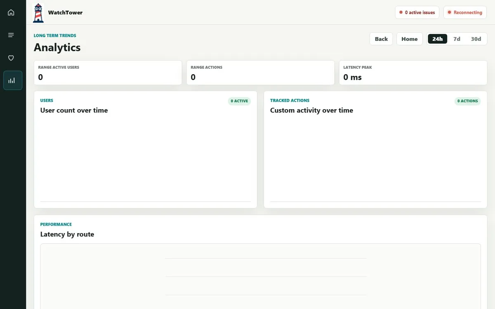
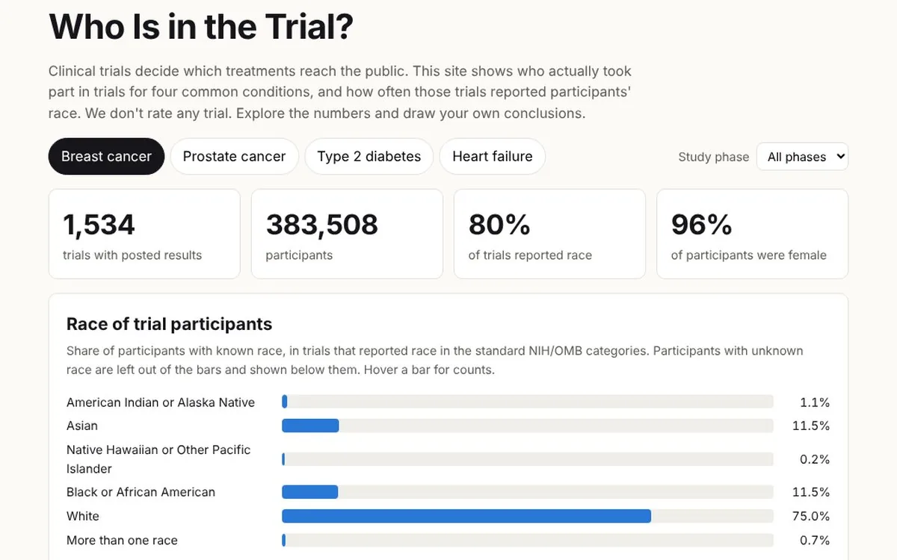
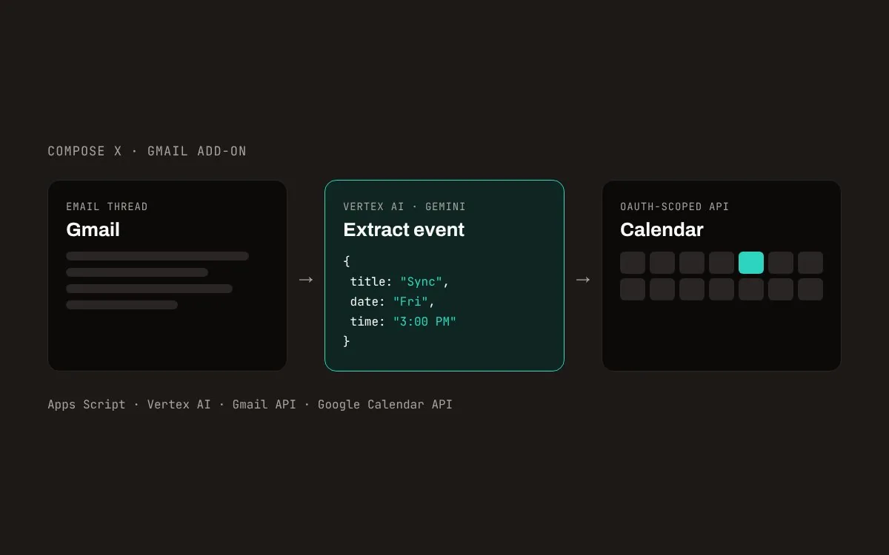

**I find where AI and software break, then fix it before attackers do.**

 

<table>
<tr>
<td align="center" valign="top" width="50%"><h3>17 pp</h3>accuracy drop a vision model never flagged, in ShowBrand</td>
<td align="center" valign="top" width="50%"><h3>2nd</h3>AI in Healthcare track, Solix Empower Hackathon 2026</td>
</tr>
<tr>
<td align="center" valign="top" width="50%"><h3>4 stages</h3>AI red team process presented to the LG Uplus CTO</td>
<td align="center" valign="top" width="50%"><h3>33 → 1</h3>unvalidated env vars replaced by one fail-fast module at Match'a</td>
</tr>
</table>

 

## About

**Technical Lead Intern, Match'a** (since Jun 2026) · I own the platform's architecture and lead 3 engineering interns. I closed an unauthenticated Twilio webhook, scrubbed PII out of Sentry error reports and rate limited the LLM endpoints before launch.

**AI Red Team Intern, LG Uplus** (Jun to Jul 2026) · In the Information Security Center of one of South Korea's three major telecom carriers, I designed a 4-stage process for finding unregistered AI assets and managing what they expose. Attacks map to MITRE ATLAS and the OWASP LLM Top 10, and AVS, a severity score I designed, makes findings comparable across the org.

**UC San Diego** · B.S. in Computer Science, graduating August 2027. Faculty Mentor Program researcher with Prof. Pengtao Xie (ECE). Based in San Diego.

**Looking for** · Security Engineering and AI Security internships for Summer 2027 and full-time roles starting August 2027.

 

## Projects

*Ranked by impact.*

### [ShowBrand](https://github.com/woosik-study/ShowBrand-Product) &nbsp;`AI` `Security`
**Found a model that stayed confident while it got 17 points less accurate.** I built an evaluation pipeline that ran 4 controlled experiments over 136 product images (occlusion, noise, low resolution, manipulation). Accuracy fell 17 percentage points and confidence moved 0.7. Any system gating on that confidence score would never know. Presented at MURALS 2026 and selected for the UCSD Undergraduate Research Hub Student Spotlight.

*Python · PyTorch · OpenCV · CLIP · MobileNet · Next.js · Claude API*

 

### [Coverage Keeper](https://github.com/AdityaJadhav17/coverage-keeper) &nbsp;`AI` `Full-stack`
**Placed 2nd in the AI in Healthcare track with a team of 3.** Photograph a Medicaid letter and see what it asks for, when it is due and who to call. I built the letter reader backend with upload validation and structured output, the guardrail that blocks any eligibility verdict, the labeled eval set, and multi-page support for photos and PDFs. It reads the deadline right on 24 of 24 test letters.

[Live app](https://coverage-keeper.vercel.app) &nbsp;|&nbsp; *Next.js · TypeScript · Claude API · Vitest · Playwright*

 

### [WatchTower](https://github.com/cse110-sp26-group09/Watchtower-Course-Project) &nbsp;`Full-stack` `Security`
**Found and fixed a stored XSS in the dashboard's HTML escaping.** On a team of 11 in CSE 110, I worked as backend and QA engineer on a self-hosted monitoring platform. Its browser SDK sends errors, performance data and user activity to a Node.js API backed by Supabase, and a Clerk-protected dashboard shows it live.

[Live](https://cse110-sp26-group09.github.io/Watchtower-Course-Project) &nbsp;|&nbsp; *JavaScript · Node.js · Supabase · Clerk · Jest · Playwright*

 

### [Who Is in the Trial?](https://github.com/woosik-study/clinicals) &nbsp;`Data`
**Compared who joins clinical trials with who actually has the disease.** A pipeline pulls trials with posted results from the ClinicalTrials.gov API and computes a participation to prevalence ratio against SEER data for breast and prostate cancer. The site covers four conditions with phase filters and charts.

[Live](https://woosik-study.github.io/clinicals) &nbsp;|&nbsp; *Python · ClinicalTrials.gov API · JavaScript · GitHub Pages*

 

### [Compose X](https://github.com/woosik-study/email-generator) &nbsp;`AI`
**Turned emails into calendar events with one click.** On a Likelion UCSD team building a Gemini-powered Gmail add-on, I owned the calendar module: parsing dates and times from AI output and creating events through OAuth-scoped Calendar API access.

*Apps Script · Vertex AI · Gemini · Gmail API · Calendar API · OAuth 2.0*

<b>More work</b>

 

**Youngduk Electronics (2017 to 2020).** At an electronic components distributor in Korea, I built the automated inventory tracking system the company ran on, cutting stock discrepancies by 30%, and integrated live exchange rates into the ERP for 20% better financial accuracy.

**Republic of Korea Army (2020 to 2022).** Basic training team leader for 36 recruits.

**Triton Engineering Student Council.** Web developer on the tech team (React, TypeScript, Vite, Tailwind).

 

## Toolkit

| Area | Tools |
|:--|:--|
| **Languages** |  Python · TypeScript · JavaScript · C · C++ · Java · SQL · ARM assembly · Bash |
| **Security** | MITRE ATLAS · OWASP LLM Top 10 · Garak · PyRIT · Threat modeling · Webhook signature validation · Rate limiting · PII scrubbing |
| **AI & ML** |  PyTorch · OpenCV · CLIP · MobileNet · Claude API · Vertex AI · Gemini |
| **Web & Backend** |  React · Next.js · Node.js · Supabase · Postgres · Clerk · zod |
| **Tools** |  Git · GitHub Actions · Playwright · Jest · Vitest · Sentry · PostHog · Linear · Linux |

 

Email me at [wok017@ucsd.edu](mailto:wok017@ucsd.edu) about security roles or any project above.

